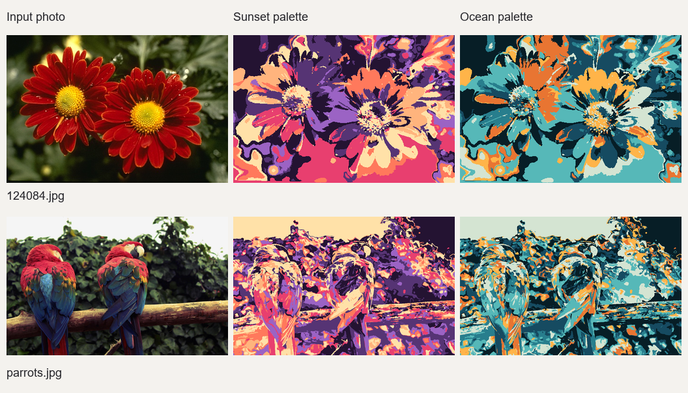

# Final results and verification

The final implementation uses the supplied `ImageAbstraction` source, including its final integer labels and modal region colors. The ready-to-run executable is `bin/recolor.exe`. Shared GCC/CMake/OpenCV dependencies are in `D:/WorkStation/tools`.

## Results and comparisons

[Open the gallery](results/index.html) for all twelve inputs, their abstractions, and the sunset/ocean recolorings. Each image directory contains exactly the two recolorings, `abstraction.png`, `labels.yml`, and `timing.txt`. Label maps and abstraction images allow another palette to be applied without repeating preprocessing.



[Full supplied-image comparison](results/comparison.jpg) includes the abstraction stage. [Segmentation comparison](results/method-comparison.png) shows the previous graph baseline beside the final method on the same paper photographs; this composite is retained for comparison, while standalone superseded outputs have been removed.

## Verification

All six supplied images produced label maps and abstraction images that matched the existing standalone ImageAbstraction results pixel-for-pixel. Every final recoloring uses only its palette and has one color per supplied region. Source images remained unchanged. Both palettes were checked on all twelve inputs. The six paper inputs have no standalone reference label maps, so the exact-reference claim applies to the six supplied images only.

Verification records are in `results/verification/`:

- `reference-checks.json`: zero differing label and abstraction pixels on all six supplied images.
- `output-checks.json`: palette, region consistency, source-color, and input-integrity checks.
- `paper-example-checks.json`: checks for all six paper inputs.
- `source-hashes.json`: supplied abstraction source hashes; before/after integration equality was verified.

The final code passed all four CTest entries: recoloring correctness, abstraction/YAML integration, CLI help, and invalid parameter rejection. The build using shared tools was also verified. Generated build and IDE caches were removed after successful checks; `build.ps1` recreates the build directory.

## Timings

Measured on 19 October 2026: Windows x64, Intel Core i7-7800X at 3.50 GHz, Release build, GCC 16.2.0, OpenCV 4.12.0, one OpenCV thread. No resizing or GPU. Defaults: mask 160, gamma 1, threshold 3, minimum seed size 11, hops 10, growth 100, 64 histogram bins, 580 requested background regions. Recoloring uses RGB distance and the seven-color sunset palette.

### Supplied images

| Image | Dimensions | Regions | Fresh abstraction (s) | Recoloring median (ms) |
|---|---:|---:|---:|---:|
| 124084.jpg | 481 x 321 | 1,451 | 8.56 | 5.74 |
| cabbage1024.jpg | 1024 x 768 | 11,548 | 43.04 | 56.58 |
| landscape.jpg | 640 x 426 | 5,175 | 15.26 | 14.91 |
| orzan.jpg | 1024 x 766 | 5,357 | 44.43 | 32.64 |
| parrots.jpg | 1024 x 640 | 5,902 | 37.40 | 24.88 |
| WuZhen.jpg | 800 x 600 | 12,400 | 30.42 | 45.70 |

### Paper examples

| Image | Dimensions | Regions | Fresh abstraction (s) | Recoloring median (ms) |
|---|---:|---:|---:|---:|
| bicycle.jpg | 1024 x 682 | 27,795 | 38.46 | 67.06 |
| lanterns.jpg | 481 x 321 | 1,425 | 7.93 | 5.22 |
| lizard.jpg | 481 x 321 | 4,138 | 8.36 | 9.80 |
| rust.jpg | 1024 x 768 | 14,625 | 40.65 | 42.41 |
| starfish.jpg | 481 x 321 | 2,763 | 8.21 | 7.54 |
| venice.jpg | 1024 x 681 | 17,390 | 36.76 | 44.82 |

Supplied-image abstraction times were measured in a fresh first pass. Final modal-color recoloring medians were measured over seven separate cached runs using those exact labels and colors. The retained per-image timing logs keep the abstraction-stage measurements and final recoloring timings, omitting superseded original-mean recoloring values. Paper-example timings come from fresh abstraction followed by seven recoloring runs. CSV files are under `results/images/` and `results/examples/`.

A separate final-default run on `124084.jpg` took 9.284 seconds including loading and requested outputs: 9.254 seconds abstraction and 5.330 ms recoloring. It matched cached-label/color reuse exactly. Its timing evidence is retained as `results/fresh-run-timing.txt`; duplicate validation images were removed after equality checks.

Recoloring medians exclude loading, YAML parsing, and encoding. Printed wall times include all repetitions and requested outputs. Abstraction dominates fresh-run cost; saved labels and abstraction colors skip it for palette changes. Timings vary with system load and are not a direct comparison with the paper's hardware or segmentation settings. These measurements were not repeated solely for folder cleanup or tool relocation.

## Reproduce

```powershell
.\build.ps1
.\run-examples.ps1 -InputDirectory images -OutputDirectory results\images
.\run-examples.ps1
```

The default batch run saves only final outputs and reusable labels/colors. Add `-Diagnostics` if CRGF caches and flat-color diagnostics are needed. See `README.md` for build paths, parameters, formats, and remaining implementation choices. Exact published figures also depend on historical settings and palette values, which are not fully specified by the PDF.
